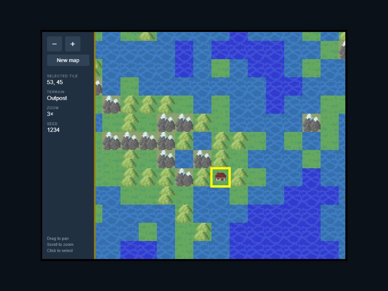

# PixiJS Tilemap

A zoomable, draggable tilemap built on **PixiJS 8**, split into a reusable core
library and a demo application.



---

## Quick start

Requires **Node ≥ 20.19** (22 LTS recommended).

```bash
npm install
npm run dev        # http://localhost:5173
```

Append `?seed=1234` to the URL to reproduce a specific map.

On this machine Node lives inside WSL rather than on Windows — see
[docs/development-setup.md](docs/development-setup.md) for the exact commands.

---

## Layout

```
packages/core/     @pixitilemap/core — the reusable library
packages/demo/     the application that uses it
legacy/            the January 2022 build, kept for reference
docs/              setup, architecture, code review, migration notes
```

### `@pixitilemap/core`

Three layers that can be taken one at a time:

|                        |                                                                |
| ---------------------- | -------------------------------------------------------------- |
| `TilemapModel`         | the grid of terrain ids. No PixiJS import — runs in plain Node |
| `TilemapView`          | a real `Container` subclass that renders a model as sprites    |
| `TilemapController`    | pan, zoom, hover and tile picking on top of a view             |
| `TerrainAtlas`         | maps a terrain id to a texture, so any tileset works           |
| `MapGenerator` / `Rng` | pluggable terrain generation, reproducible from a seed         |

`pixi.js` is a peer dependency, so the host application chooses the version.

See [docs/architecture.md](docs/architecture.md) for the reasoning and
extension points.

---

## Scripts

| Command             | What it does                            |
| ------------------- | --------------------------------------- |
| `npm run dev`       | demo with hot reload                    |
| `npm test`          | core unit tests                         |
| `npm run typecheck` | type-check both packages                |
| `npm run build`     | build the library, then the demo        |
| `npm run verify`    | format check → typecheck → test → build |

---

## Documentation

- **[Development setup](docs/development-setup.md)** — prerequisites, commands,
  WSL notes, troubleshooting
- **[Architecture](docs/architecture.md)** — how the pieces fit and how to reuse
  them
- **[Code review of the 2022 build](docs/code-review-legacy.md)** — what was
  wrong, measured against the running application
- **[v7 → v8 migration notes](docs/migration-v7-to-v8.md)** — old API beside new

---

## History

The project started as a plain-JavaScript Pixi 1.5 demo and was carried forward
version by version — 2.2.7, 3.0, 4.8.9, 5.3.12, 6.5.8, 7.1.1 — with each round of
breaking changes recorded in the README as it went. That log is the
[changelog](#changelog) below; it is a genuinely useful account of how much
churn the v3–v7 era involved, and the 2022 README it came from is reproduced
verbatim in [`legacy/README.md`](legacy/README.md).

In November 2026 the project was rewritten for PixiJS 8.23 in TypeScript, and
restructured around the library/demo split above. The rewrite also fixed four
defects that predated the upgrade: off-by-one tile selection at low zoom, a
misspelled setting that silently disabled nearest-neighbour filtering, a shared
prototype object that made a second map instance impossible, and a map-generation
loop that could hang the tab.

The 2022 code is preserved under [`legacy/`](legacy/) and still runs.

---

## Changelog

Oldest first, so each entry reads as the next thing that happened. The 2022
entries are the original upgrade notes, restored.

### 2022-01-22 — jQuery 3.6.3; PixiJS 1.5.1 → 4.8.9

Upgraded jQuery to 3.6.3 (no problem), and PixiJS from v1.5.1 to 2.2.7 (no
problem). From v3 onwards they have massive changes every major version — 3, 4,
5, 6, 7 — and the target was the then-latest, 7.1.

**v2.2.7 → v3.0.0**

- PixiJS no longer uses the old loader from v3; changed to the new `Loader`.

**v3.0.0 → v4.8.9**

- `loader.onComplete.add` is only available from v4.8.8.
- No more `requestAnimFrame` — use `requestAnimationFrame`.
- `data.getLocalPosition`: `data.constructor.toString()` gives
  `InteractionEvent`. PixiJS now has `PIXI.InteractionData` with
  `getLocalPosition`, which should help if it is converted to one — and it
  turned out they had moved `InteractionData` into the `.data` object inside
  the event, so the code was changed accordingly.
- "You do not need to use a PIXI Stage any more, you can simply render any
  container" — so the stage in `main.js` went from `PIXI.Stage` to
  `PIXI.Container`.
- Still open in v4.8.9: `text style property 'font' is now deprecated, please
use 'fontFamily', 'fontSize', 'fontStyle', 'fontVariant' and 'fontWeight'`.

Dev note: PixiJS is included directly rather than imported, so every class is
reached as `PIXI.*` — e.g. `PIXI.TextStyle`. That may cause issues if this is
pulled into another project that uses modules. `pixi.dev.js` is no longer in
use, because it is linked straight from PixiJS's own server instead.

### 2022-01-23 — PixiJS 4.8.9 → 7.1.1

**v4.8.9 → v5.3.12**

A bigger change than v4, so the
[v5 migration guide](https://github.com/pixijs/pixijs/wiki/v5-Migration-Guide)
was consulted — but it misses a great many of the actual changes.

- Frame loading changed. `Sprite.from` did not work; it seems that from v5 Pixi
  uses [resource-loader](https://github.com/englercj/resource-loader), which
  takes a dictionary rather than an array for frames, so the JSON was changed to
  match. The `file_name` field was kept as it was, for easier referencing. The
  result is much faster, thanks to the new render engine.
- `menu.js:38 Uncaught TypeError: button.setStyle is not a function` — `button`
  is a `Text`, so every `button.setStyle()` became `button.style = …`; the new
  `Text` uses the new `TextStyle` structure with `fontFamily` and `fontSize`,
  so that changed too.
- Warnings cleared: `PIXI.loader` → `PIXI.Loader.shared`, and
  `PIXI.Sprite.fromFrame` → `PIXI.Sprite.from`.

**v5.3.12 → v6.5.8**

The loader mechanism changed again — loaders replaced by assets. In v6 `Assets`
is only an opt-in package, so the v6 upgrade was left where it stood; it still
works, with a deprecated-loader warning.

**v6.5.8 → v7.1.1**

- `Assets` is inside Pixi from v7, so it could finally be used.
- `tilemap.js:5 Uncaught (in promise) TypeError: Class constructor Container
cannot be invoked without 'new'` — `PIXI.Container.call(this)` became
  `new PIXI.Container(this)`.
- `InteractionManager` is replaced by `EventSystem`, so the `mouse*` handlers
  moved to `obj.on('event', fn)`. That brought another problem: the handler's
  `data` is a `FederatedMouseEvent` now, not an `InteractionEvent`, so
  `data.data.getLocalPosition` is gone. The code uses
  `FederatedMouse`/`PointerEvent` instead, with `event.client` in place of
  `getLocalPosition`.

### 2023-01-28 — tidy-up

`tilemap.js` cut down by a third, with the map-building code pulled apart into
smaller pieces.

### 2026-11-22 — PixiJS 8.23, TypeScript, library/demo split

Rewritten for PixiJS 8.23 in TypeScript and restructured into
`@pixitilemap/core` plus a demo that uses nothing a third party could not, so
the library is reusable rather than demo-shaped. Tests run on Node with no
browser and no GPU.

Four defects that predated the upgrade were fixed, each measured against the
running 2022 build first:

- tile selection landed about a tile below the pointer at zoom 1–2, because
  pointer events were read in browser-viewport coordinates;
- `PIXI.settings.SCALE_MODES` is a misspelling of `SCALE_MODE`, so
  nearest-neighbour filtering was never applied and zoomed-in tiles were blurred;
- `Tilemap.prototype = new PIXI.Container()` made one container instance the
  shared prototype, so a second map instance was impossible;
- map generation could spin forever in `while (!found)` when no grassland
  existed.

Wheel and trackpad zoom were made usable, and the browser stopped from stealing
the gesture. `origin/fix/selectile` was audited against the measured defects,
found to be superseded, and deleted; it is kept as the tag
`archive/fix-selectile`.

## License

MIT
